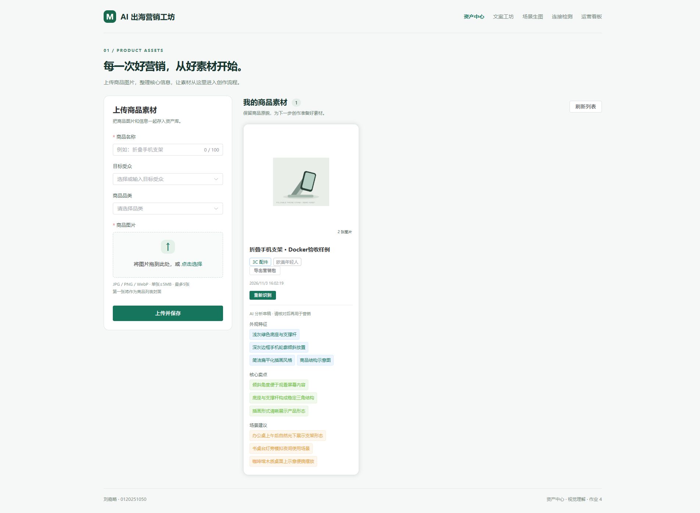
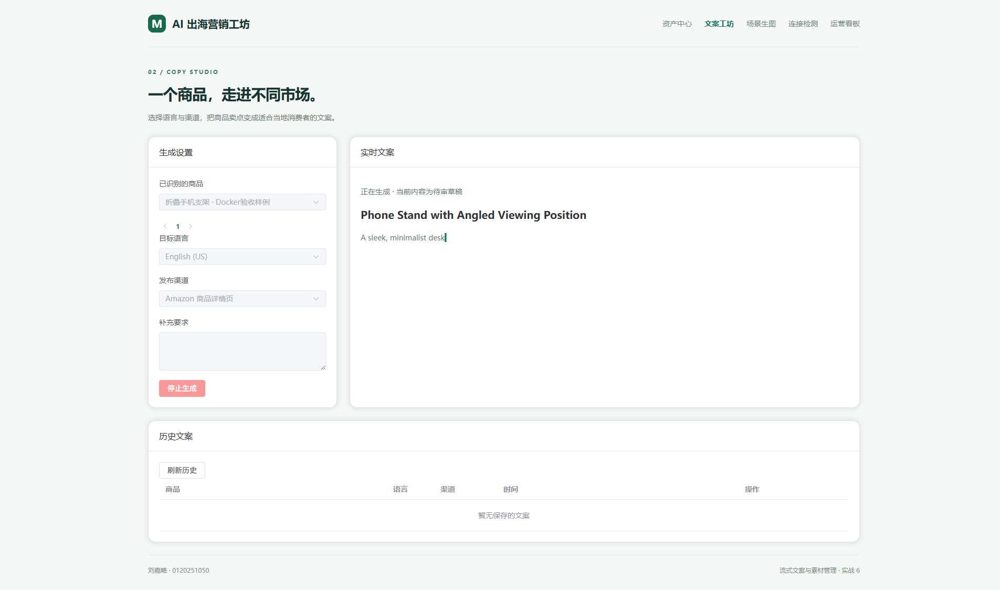
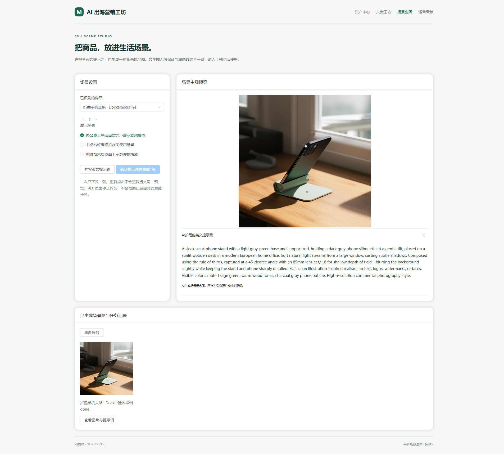
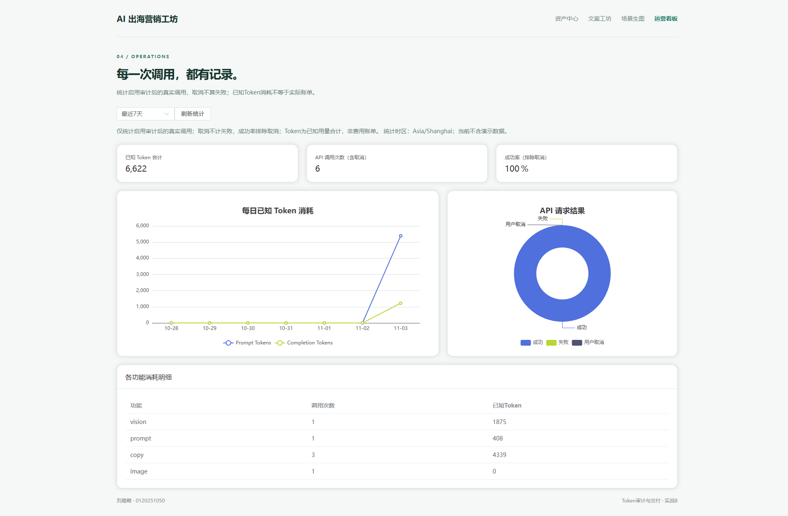

# AI 出海营销工坊

上传商品图 → AI结构化识别 → 三语三渠道流式文案 → 异步场景图 → ZIP营销包 → Token运营看板。

刘嘉略 · 学号0120251050。课程演示应用，AI输出保留为待审核草稿，不替代商品实拍或参数证明。

## 功能

- 多张JPEG/PNG/WebP上传，真实解码重编码，分页素材中心。
- 多模态结构化JSON识图，严格校验，格式错误最多重试一次。
- 英/日/西三语，Amazon/TikTok/Instagram三渠道；SSE、停止生成、Markdown及DOMPurify净化。
- LLM扩写英文提示词，用户确认后万相异步生成一张；约3秒轮询，本地持久化与历史预览。
- 浏览器JSZip导出images/、copy/及README.txt，导出失败不交付残缺包。
- 统一审计文本、识图、扩写、流式和生图创建请求；ECharts按上海时区展示已知Token及请求结果。

## 技术栈

| 层 | 技术 |
|---|---|
| 前端 | Vue 3、Vite 8、Element Plus、Pinia、Vue Router、ECharts、JSZip |
| 后端 | Node.js 24、Express、Mongoose、Multer、Sharp |
| 数据 | MongoDB |
| AI | 百炼Qwen3-VL-Plus、Qwen-Plus、Wan2.1-T2I-Turbo |
| 部署 | Docker Compose、Nginx多阶段构建、具名数据卷 |

## Docker启动

需要可运行的Docker引擎和Docker Compose。

1. 克隆本仓库后进入根目录。
2. 将server/.env.example复制为server/.env，填自己的DASHSCOPE_API_KEY、所属地域的LLM_BASE_URL及模型名。已有.env不要覆盖。
3. 执行`docker compose up -d --build`。
4. 访问http://localhost:8080，健康检查http://localhost:8080/api/health。

仅前端映射本机127.0.0.1:8080；backend:3000和mongo:27017只在Compose内部网络。持久化使用mongo-data、uploads-data。`docker compose restart`保留数据，普通`docker compose down`也保留数据卷；不要随意加-v。

前端镜像第一阶段用Node构建，第二阶段仅复制静态dist到Nginx，因此最终前端镜像无需Node和node_modules。后端镜像仍需要Node执行Express，这两种镜像不要混淆。

## 本地开发

需要Node 24及本机MongoDB。根目录执行`npm --prefix server ci`和`npm --prefix client ci`，按上文准备server/.env并检查CORS_ORIGIN与开发前端地址匹配。两个终端分别执行`npm run dev:server`与`npm run dev:client`。默认后端3100、前端5174；开发API地址来自client/.env.development，生产VITE_API_BASE留空、由Nginx同域代理。

## 环境变量

| 变量 | 含义 | 要求 |
|---|---|---|
| PORT / HOST | 后端端口及监听地址 | Docker覆盖为3000/0.0.0.0；本机默认3100/127.0.0.1 |
| MONGO_URI | 数据库地址 | 必填；Compose覆盖为mongo服务地址 |
| CORS_ORIGIN | 允许的浏览器开发源，逗号分隔 | 跨域开发时必填；同域生产由Compose给出 |
| DASHSCOPE_API_KEY | 百炼密钥 | 真实AI调用必填，只在后端运行时注入 |
| LLM_BASE_URL | 与Key匹配的兼容接口地址 | 使用自己工作空间、地域的地址 |
| VISION_MODEL | 视觉模型 | 示例qwen3-vl-plus |
| TEXT_MODEL | 文本/扩写模型 | 示例qwen-plus |
| IMAGE_MODEL | 万相异步模型 | 示例wanx2.1-t2i-turbo |
| IMAGE_BASE_URL | 生图原生API根地址 | 可选；默认从LLM_BASE_URL派生同地域/api/v1 |
| VITE_API_BASE | 浏览器API前缀 | 生产必须为空，禁止放密钥 |

## 实际接口约定

JSON统一`{code,message,data}`，0成功、错误data:null。SSE在校验通过后改用event/data/空行帧，delta为增量，done为已保存结果，error为可读失败；delta可含reset:true表示质量重写。

| 方法 | 路径 | 说明 |
|---|---|---|
| GET | /api/health | API及MongoDB状态 |
| POST | /api/products | multipart：name、audience、category、images数组1～5张，单图≤5MB |
| GET | /api/products?page=1&size=20 | 分页产品，size≤50 |
| POST | /api/products/:id/analyze | 前三图多模态识别并保存 |
| POST | /api/copy/generate | productId/language/channel/extra；非流式兼容接口 |
| POST | /api/copy/stream | 同上；流式、完成保存、断开中断上游 |
| GET | /api/assets?productId=...&type=copy或image | 最近最多100条素材 |
| DELETE | /api/assets/:id | 删除素材记录；前端二次确认 |
| POST | /api/images/preview | productId、sceneIndex 0～2，返回previewId与提示词 |
| POST | /api/images/generate | previewId，确认后下发一张图，HTTP202 |
| GET | /api/images/tasks/:assetId | pending/done/failed、本地图片地址与失败原因 |
| GET | /api/stats/overview?days=7 | 1～30天，上海时区、缺日补零，默认排除demo |
| GET | /uploads/UUID.ext 或 /uploads/generated/UUID.png | 受限本地图片路径 |

## 目录

```text
client/src/api/          请求封装
client/src/components/  上传、商品卡、Markdown
client/src/utils/       SSE读取与ZIP导出
client/src/views/       资产、文案、场景、看板
client/nginx.conf       32MB上传、同域代理、SSE不缓冲
server/src/controllers/ 资源与任务接口
server/src/services/    统一模型出口、审计、图像与Prompt
server/src/models/      Product、MarketingAsset、TokenLog
server/src/middlewares/ 校验、上传、合规及错误处理
server/test/            临时数据库和受控模型测试，不额外消耗模型额度
server/scripts/         明确命名的人工诊断/调优脚本，可能真实调用模型
server/uploads/         运行时图片，不进入Git或镜像
docs/                   实现说明与验收证据
docker-compose.yml      三服务与两持久化卷
```

## 验证

测试前须启动可连接的MongoDB，并通过MONGO_URI指向它。`npm --prefix server test`在该服务内创建随机名称的临时数据库，结束删除自己的测试库；测试不调用真实模型。`npm run build`构建前端。Docker验收以docs中的实际记录为准，不能用本地开发截图替代容器运行证明。

审计只覆盖启用之后的调用。未知Token为null，看板显示已知合计及缺失数量；用户取消不算失败，成功率排除取消。生图0个文本Token不代表免费，image请求成功只表示任务被接受，不等于成图必然成功。

## 已遇到的问题

1. Key返回AccessDenied：在同地域、同业务空间为现有Key补充具体模型权限，不要重置或授权全部模型。
2. 模型JSON/文案不合规：Prompt约束之外做严格校验，重试一次仍失败就报错，不把草稿保存成合格结果。
3. 停止按钮被禁用：表单整体禁用会连带停止按钮，改为只禁用参数选择，保持停止可点击。
4. 生图预览裁切：容器设置明确高度并使用contain，生成结果下载后用本地路径预览。
5. Nginx下SSE缓冲：关闭proxy_buffering与proxy_cache，使用HTTP/1.1，300秒读取超时。
6. ZIP图片损坏：必须检查HTTP状态并读取Blob，解压后校验图片/文案非空及渠道结构。

## 限制

目前无用户鉴权、共享队列或商业合规保证；请仅在本机课程环境运行。识图和文案均需人工核对；生成图可能与商品结构不同，也可能未完全服从无标志要求。每份素材默认draft，不能直接当实物证明发布。导出最多100条素材并限制图片体积；达到列表上限会报错避免悄悄遗漏。多实例部署需共享任务锁。

## 截图与归档

关键页面和实际验收记录见docs/验收记录及docs/screenshots。课程提交物单独保存在电商作业文件夹，与GEO分开。

仓库：https://github.com/1352933271-spec/ai-marketing-workshop

## 本次交付验收（2026-11-03）

38项后端测试、前端生产构建通过；前后端npm audit均为0个已知漏洞。以无node_modules的新目录构建并复用交付数据卷，健康检查通过；compose restart后商品与图片仍可读取。仅8080映射到宿主机。真实AI全链路记录位于docs/验收记录。








